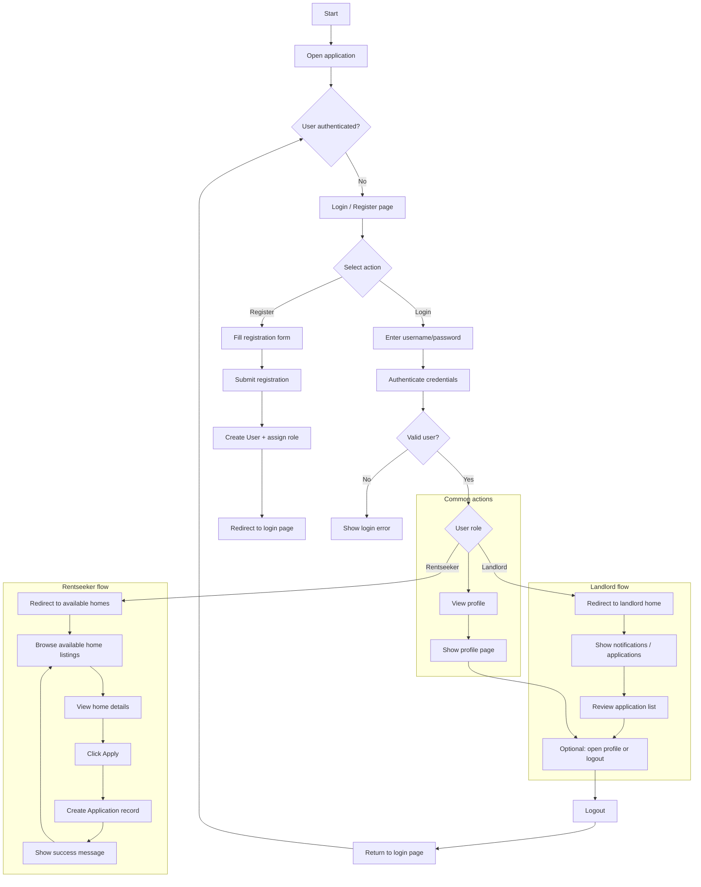

# Process Model Diagram for Gharbhanda Management System

## Summary
This document describes the main process flows for registration, login, home browsing, applying, and landlord notification management.

## Mermaid Flowchart

## Process Model Details

### 1. User authentication process
- User visits the app.
- If unauthenticated, the app displays `Login` / `Register`.
- Registration creates a Django `User`, assigns the selected `rentseeker` or `landlord` group, and redirects to login.
- Login authenticates credentials and routes the user based on their role.

### 2. Rentseeker process
- Rentseeker lands on `home.html`.
- They browse available homes loaded from `Home.objects.all()`.
- They can view details for a chosen house from `view_details`.
- Applying triggers `process_apply`, which stores an `Application` model record and returns to the home list.

### 3. Landlord process
- Landlord lands on `llhome`.
- The landlord sees `Application` records filtered by `request.user`.
- They can review applications and optionally view their `llprofile` or logout.

### 4. Common pages
- About page: `about.html`
- Contact page: `contact.html`
- Profile page: `profile.html` or `llprofile.html`

## How to view
- Open `process_model_diagram.md` in VS Code to preview the Mermaid diagram.
- Use the flowchart as a reference when drawing a hand-drawn or tool-based process modelling diagram.
